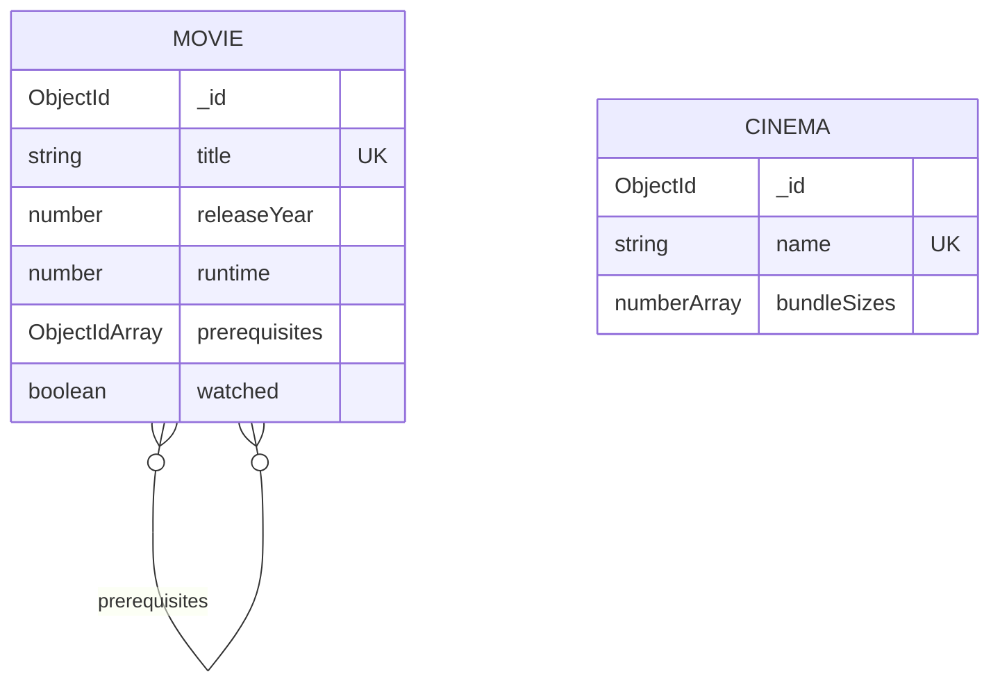

# Doomsday Ready

A small full-stack app for MCU fans to plan their rewatch before *Avengers: Doomsday* and book an opening-night watch party.

## Stack

- Backend: Node.js, Express, MongoDB (Mongoose)
- Frontend: React (Vite), React Router, Axios
- Optional: Docker Compose (MongoDB + backend + frontend)

## Run locally

Start the backend:

```bash
cd backend
npm install
copy .env.example .env     
npm run dev
```

Start the frontend in a second terminal:

```bash
cd frontend
npm install
copy .env.example .env
npm run dev
```

Open the Vite URL (usually http://localhost:5173).

To load the assessment's sample data (8 movies, 4 cinemas):

```bash
cd backend
npm run seed
```

This clears the movies and cinemas collections first, then inserts the sample data.

## Run with Docker Compose

```bash
docker compose up --build
```

This starts MongoDB, the API on http://localhost:5000, and the built frontend on http://localhost:8080.

To load sample data in Docker mode:

```bash
docker compose exec backend npm run seed
```

## API endpoints

| Method | Path | Purpose |
| --- | --- | --- |
| POST | `/api/movies` | Create a movie |
| GET | `/api/movies` | List movies |
| PATCH | `/api/movies/:id` | Update a movie (including watched and prerequisites) |
| GET | `/api/movies/:id/rewatch-order` | Rewatch order (feature 1) |
| POST | `/api/cinemas` | Create a cinema |
| GET | `/api/cinemas` | List cinemas |
| GET | `/api/cinemas/:id/booking?groupSize=N` | Booking quote (feature 2) |

## Features

### 1. Movies and rewatch order

A movie has a unique title, release year, runtime (1–300 minutes), optional prerequisites, and a watched flag (default `false`).

- Creating or updating a movie in a way that would make it depend on itself — directly or through other movies — is rejected with `409 CIRCULAR_DEPENDENCY`.
- Cycle detection is a hand-written depth-first search over the prerequisite graph. It runs on update; on create there is no id yet and nothing can reference the new movie, so a cycle is impossible.
- `GET /api/movies/:id/rewatch-order` returns every prerequisite (transitively), each exactly once, in a valid order where a movie always comes after its prerequisites. The target is excluded. It also returns `watchedCount` and `unwatchedRuntime`.
- The ordering is a hand-written DFS topological sort (post-order), with no graph library.

### 2. Cinemas and watch-party booking

A cinema has a unique name and 1–10 bundle sizes, each between 1 and 500 seats.

- `GET /api/cinemas/:id/booking?groupSize=N` (N from 1 to 10,000) returns the fewest bundles whose seats add up to exactly N, and how many of each size to buy — or reports that no exact combination exists.
- The quote uses a hand-written dynamic-programming solution (coin-change style), then reconstructs the chosen bundles. No library.

### 3. Frontend

Three views:

- **Movies** — add movies, edit prerequisites (options that would create a loop are disabled and labelled), tick movies as watched.
- **Rewatch Plan** — pick a target, see the ordered list with watched items struck through, a progress bar ("4 of 7 watched"), and the remaining watch time.
- **Booking** — pick a cinema, enter a group size, see the bundles to buy or "not possible".

## Data model



`prerequisites` holds ObjectIds referencing other `Movie` documents, so a movie can point to many movies and be pointed to by many. Titles and cinema names are unique indexes.

## Assumptions

- Movie titles and cinema names are unique; duplicates return `409 DUPLICATE_TITLE` / `409 DUPLICATE_NAME`.
- `GET /api/movies` populates prerequisite ids with their titles for display; the API still accepts and stores ids.
- Cycle checks run on `PATCH` (update). A brand-new movie cannot be referenced yet, so creation cannot create a cycle.
- For ties in bundle count, the algorithm prefers smaller bundle sizes first.
- The sample movie data in the assessment is for the challenge, not an official watch guide.

## AI usage

AI (OpenCode) was used as an interactive guide: it explained each piece, provided code snippets, and helped debug setup and UI issues. The feature logic itself — cycle detection, topological sort, and the booking dynamic-programming solution — was written as required by the assessment, with no libraries that solve those problems.

## Bonus

- Data model diagram (above).
- `docker-compose.yml` starts the whole stack with one command.
"# Doomsday-Ready" 
